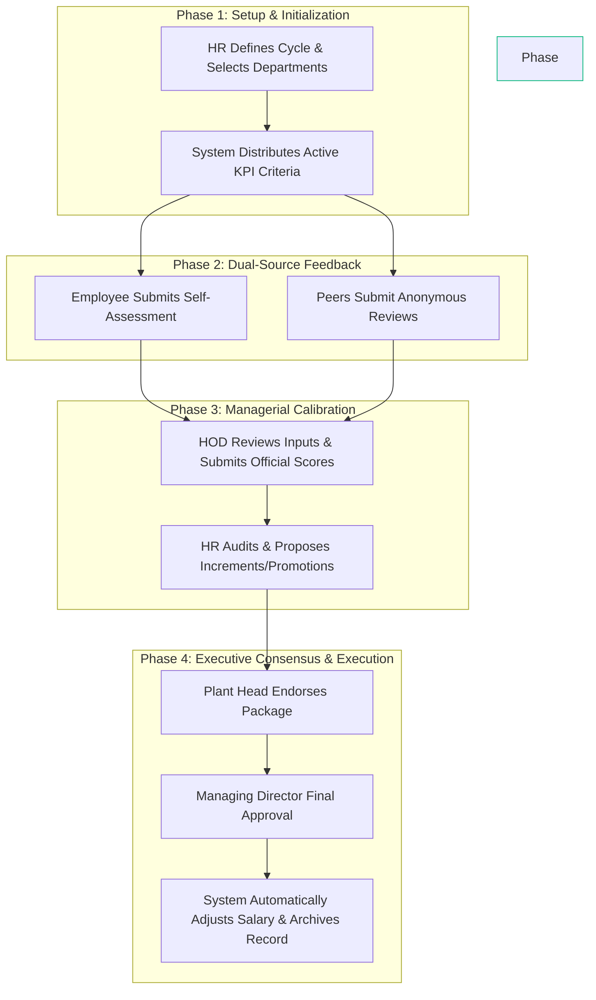

# CRIPTON HRIS — KPI Performance & Appraisal Module
## Ultimate Business & Executive Presentation Guide
---

### Executive Overview: Why This System Matters

Traditional performance appraisal systems often suffer from key limitations: supervisor bias, lack of transparent metrics, manual data entry errors, and poor alignment between individual effort and corporate budget constraints. 

The **CRIPTON KPI Performance & Appraisal Module** solves these issues by creating a single, automated, and secure digital platform. It connects employees, peers, department heads, HR officers, operations leaders, and executive directors in a unified workspace. By evaluating staff using a combination of top-down ratings, self-reflections, and anonymous peer reviews, the organization achieves three core goals:
1. **Unbiased Evaluations**: Combining self-evaluations and peer reviews with manager scoring paints a complete, 360-degree picture.
2. **Transparent Logic**: Standardized criteria and automated calculations remove ambiguity. Employees know exactly how they are graded.
3. **Structured Governance**: A clear approval hierarchy ensures that performance-based increments and promotions are fully aligned with company policy and department budgets before a single cent is spent.

---

### Phase-by-Phase Process Flowchart

Here is the step-by-step path an employee's performance evaluation takes through the system, divided into four logical business phases:

---

### Step-by-Step Walkthrough: The Lifecycle of an Appraisal

Below is the detailed breakdown of the 8 steps. Each step is explained in plain business language, detailing the **Who**, the **What**, the **Business Rationale**, and a **Real-World Scenario**.

---

#### 1. Setup & Cycle Initialization
* **Who is responsible**: HR Department / System Administrators.
* **What happens**: HR creates a new appraisal period in the system (e.g., "Annual Review 2026"). HR sets deadlines, selects the active departments, and configures the core performance questions (KPI Criteria).
* **Business Rationale**: Every department has different goals (e.g., a factory team focuses on production efficiency, while an IT team focuses on system uptime). HR can assign specific metrics to specific departments, ensuring everyone is measured against criteria relevant to their daily responsibilities.
* **Real-World Scenario**: HR creates the "Mid-Year Review 2026" cycle. The system instantly loads the default KPI templates, customized with specific questions for the *Business Innovation* and *Finance* teams.

---

#### 2. Employee Self-Assessment
* **Who is responsible**: The individual Employee.
* **What happens**: The employee logs into their personal portal, views their designated KPIs, rates their own performance, and writes a brief justification for each rating.
* **Business Rationale**: Before a manager evaluates an employee, it is vital to let the employee share their perspective. This drives self-reflection, reduces the feeling of top-down dictation, and helps managers identify discrepancies between an employee's self-image and their actual output.
* **Real-World Scenario**: Tahmid, an Asst. Manager, rates himself a "9 out of 10" in *Decision Making & Problem Solving* because he successfully delivered three major client projects ahead of schedule, detailing this achievement in the justification box.

---

#### 3. The 360-Degree Peer Review
* **Who is responsible**: Assigned Colleagues/Peers.
* **What happens**: Selected colleagues confidentially rate the employee on five core teamwork metrics: *Teamwork, Communication, Problem Solving, Leadership, and Work Ethic*. They also provide written feedback on the employee's strengths and areas for growth.
* **Business Rationale**: Managers cannot see everything. An employee might behave perfectly in front of their HOD but create friction when working with colleagues. Peer reviews gather honest, anonymous insights from those who collaborate with the employee daily.
* **Real-World Scenario**: Three developers on the APPS team anonymously evaluate Hanif. They note that while his technical code is outstanding, he needs to improve his response times on team chat channels.

---

#### 4. Head of Department (HOD) Appraisal & Scoring
* **Who is responsible**: The Department Manager / HOD.
* **What happens**: The HOD opens the employee's assessment card. They can view the employee's completed self-assessment side-by-side with an aggregated, completely anonymous summary of the 360° Peer Review (average scores and combined comment lists). The HOD then enters the final official manager scores for each KPI.
* **Business Rationale**: The HOD makes the final decision on performance rating, but they are armed with peer feedback and self-assessment notes. This ensures their scores are balanced, objective, and defensible.
* **Real-World Scenario**: The Innovation Director opens Tahmid's appraisal. He reads Tahmid's self-justification and checks the peer report (which shows an outstanding average score of 9.2 in teamwork). Convinced, the HOD awards him high scores and officially signs off on the department review.

---

#### 5. HR Review & Recommendation
* **Who is responsible**: HR Specialists / Managers.
* **What happens**: HR audits the HOD's appraisal. The system automatically computes the final percentage score and matches it with a performance grade (e.g., A, B+, C). HR then enters administrative feedback and inputs proposed salary increments (e.g., +15,000 BDT) or promotions (e.g., from Executive to Sr. Executive) based on company guidelines.
* **Business Rationale**: Department managers may recommend high raises for all their staff. HR acts as a central coordinator, ensuring increments across the company align with salary structures, performance grades, and overall payroll budgets.
* **Real-World Scenario**: HR reviews Sultan's profile. Sultan has scored 91% (Grade A - Excellent). According to policy, Grade A employees are eligible for promotions. HR proposes his promotion to *Sr. Manager* along with a salary adjust of 19,000 BDT.

---

#### 6. Plant Head / Division Director Endorsement
* **Who is responsible**: Plant Head / Head of Operations.
* **What happens**: The operational head of the branch or plant reviews the compiled assessment dossier, including HR's proposed salary adjustments and HOD comments. They add operational remarks and approve the package.
* **Business Rationale**: Large organizations have physical sites or distinct business divisions. Plant Heads understand the operational budget and output of their specific site. Their endorsement ensures that salary changes align with the site's economic productivity.
* **Real-World Scenario**: The Plant Head reviews the list of proposed increments for the APPS team. He confirms that the site's overall output justifies the payroll updates and signs off.

---

#### 7. Managing Director (MD) Final Approval
* **Who is responsible**: Managing Director / CEO.
* **What happens**: The MD accesses the executive dashboard showing all pending appraisals. The MD can view every detail of the employee's history: HOD remarks, HR recommendations, and Plant Head notes. The MD has the authority to approve, adjust, or hold the proposals.
* **Business Rationale**: Executive management maintains ultimate control over corporate spending and leadership changes. This step ensures senior leadership is aligned with high-level talent development and company-wide budget utilization.
* **Real-World Scenario**: The MD logs in and reviews Sultan's promotion to Sr. Manager. Recognizing Sultan's successful ERP project launch, the MD stamps the final digital approval.

---

#### 8. Automated Increment & Salary Execution
* **Who is responsible**: System Automation (HRIS Engine).
* **What happens**: The moment the appraisal is marked completed after the MD's approval, the system updates the employee's gross salary field, saves the historical increment log, updates their designation, and archives the appraisal.
* **Business Rationale**: Eliminates the manual work and errors involved in updating payroll files. The transition from executive decision to system update is instantaneous and fully audited.
* **Real-World Scenario**: Tahmid's salary is automatically updated from 152,000 BDT to 167,000 BDT in the database, with an effective date set for July 2026.

---

### Core Business Logic: How the Math Works

To maintain objectivity, the system uses clear formulas to convert supervisor ratings into concrete decisions.

#### 1. How the Total Score is Calculated (Weighted Contribution)
Each KPI belongs to a category with a pre-configured weight. The system translates the raw score from the HOD into a percentage, then applies the category weight:

$$\text{Final Category Score} = \left( \frac{\text{Sum of HOD Scores in Category}}{\text{Sum of Maximum Scores in Category}} \right) \times \text{Category Weight}$$

$$\text{Total Weighted Score} = \text{Sum of all Category Scores}$$

* **Why this is fair**: An employee cannot get a high grade just by scoring well on easy organizational tasks (15% weight) if their core job output (40% weight) is poor. Focus is placed where it matters most.

#### 2. The Grade Band Rules
The final weighted score (from 0% to 100%) maps directly to a performance grade. The system strictly enforces eligibility rules for increments and promotions:

* **Outstanding (A+ | 95% - 100%)**: Eligible for both salary increments and rapid promotions. Reserved for exceptional performance.
* **Excellent (A | 85% - 94%)**: Eligible for increments and promotions.
* **Very Good / Good / Satisfactory (B+ / B / C+ | 55% - 84%)**: Eligible for standard increments, but not immediate promotion.
* **Needs Improvement / Poor / Unsatisfactory (C / D / F | Under 55%)**: **Not eligible** for increments or promotions. Automatically flags the employee for a mandatory performance improvement plan.

---

### Real-Time Management Analytics

The system generates real-time graphs and charts for executive decision-makers:
* **The Grade Distribution Chart**: Shows what percentage of the workforce falls into each grade band. This prevents "grade inflation" (where managers rate everyone as "outstanding").
* **Department Performance Averages**: Ranks departments by their average performance scores. This allows management to see which teams are excelling and which teams need additional resources or training.
* **Top Performers Spotlight**: Automatically lists the top 5 highest-performing employees in the company for immediate recognition.
