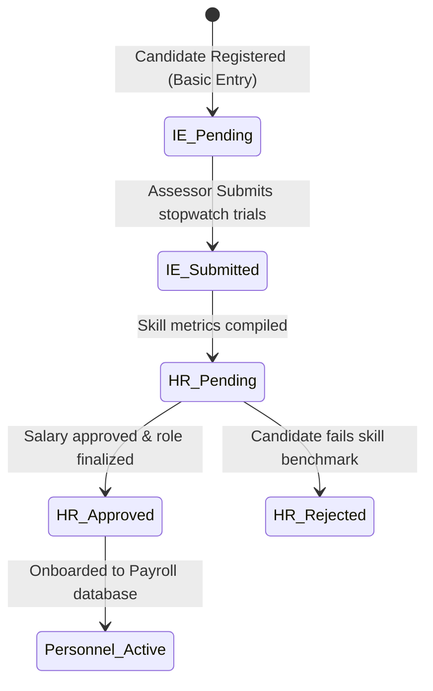

# 📖 IE Recruitment System: The Ultimate Technical Specifications, Logic Manual, & Operational User Guide

This manual represents the exhaustive, authoritative documentation for the **IE Recruitment Module** in the CRIPTON HRIS application. It describes every workflow, database schema, operational screen, button guard, state transition, and mathematical calculation.

---

## 📌 SECTION 1: System Blueprint & Candidate Lifecycle States

The IE Recruitment system manages candidates from the initial application phase to final payroll onboarding. It enforces a strict sequence of stages to maintain data integrity across the Industrial Engineering (IE) and Human Resources (HR) departments.

### 1.1 Candidate Status State Machine

Candidates advance through a series of logical states, governed by validation checks:



#### Detailed State Properties & Access Permissions:

1. **`IE Pending`**
   * **Definition**: A candidate has a Temp ID but has not yet undergone the cycle time evaluation.
   * **Form Permissions**: Candidate data is fully editable. 
   * **List Behavior**: The edit button (pencil) is **active** on the Basic Info Search List.

2. **`IE Submitted` / `HR Pending`**
   * **Definition**: Stopwatch trials have been completed, capacity computed, standard outputs matched, and recommendations submitted by the IE team.
   * **Form Permissions**: Candidate registration details are **read-only** (locked) to prevent modification of demographic or job routing details during salary evaluation.
   * **List Behavior**: The edit button (pencil) is **disabled** on the Basic Info Search List.

3. **`HR Approved`**
   * **Definition**: HR reviewed the skill evaluations and approved the proposed gross salary.
   * **Form Permissions**: The candidate record is locked.
   * **List Behavior**: A draft record is created in the **Personnel List**, with the approved salary locked.

4. **`HR Rejected`**
   * **Definition**: Candidate did not pass skill benchmarks or failed the salary agreement.
   * **Form Permissions**: The record is locked.
   * **List Behavior**: Archived in the database.

---

## 🗄️ SECTION 2: Master Configurations & Database Schemas (Admin Center)

Configurations are handled in `/recruitment-configuration`. The settings are stored as JSON arrays in browser `localStorage`.

### 2.1 The 8 Database Schemas

#### 1. Operations Master (`recruitment_config_operations`)
* **Description**: Catalog of garment manufacturing or operations tasks.
* **JSON Schema**:
  ```json
  {
    "id": "String (UUID)",
    "opName": "String (Unique)",
    "createdBy": "String",
    "updatedBy": "String"
  }
  ```
* **Duplication Logic**: Case-insensitive duplication block. Trying to save `Attach Pocket` will throw a duplicate block if `attach pocket` exists.

#### 2. Machine (M/C) Master (`recruitment_config_machines`)
* **Description**: Equipment catalog.
* **JSON Schema**:
  ```json
  {
    "id": "String (UUID)",
    "mcFullName": "String",
    "mcName": "String (Unique Short Code)",
    "createdBy": "String",
    "updatedBy": "String"
  }
  ```

#### 3. Operation Grade (`recruitment_config_op_grades`)
* **Description**: Performance grades mapped to specific operations.
* **JSON Schema**:
  ```json
  {
    "id": "String (UUID)",
    "grade": "String (e.g. A, B+, C)"
  }
  ```

#### 4. Measurement (`recruitment_config_measurements`)
* **Description**: Fabrics or parts dimension specifications.
* **JSON Schema**:
  ```json
  {
    "id": "String (UUID)",
    "name": "String (e.g. 44 CM)"
  }
  ```

#### 5. SMV Bank (`recruitment_config_smv_bank`)
* **Description**: Relational database linking tasks to standard minute values.
* **JSON Schema**:
  ```json
  {
    "id": "String (UUID)",
    "opName": "String (Ref -> Operations)",
    "mcName": "String (Ref -> Machines)",
    "opGrade": "String (Ref -> Operation Grade)",
    "meas": "String (Ref -> Measurement)",
    "smvValue": "String (Decimal format, e.g. 0.25)"
  }
  ```

#### 6. Efficiency Grade Points (`recruitment_config_eff_grades`)
* **Description**: Translates candidate tested efficiency to Grade Point weights.
* **JSON Schema**:
  ```json
  {
    "id": "String (UUID)",
    "effFrom": "String (Decimal)",
    "effTo": "String (Decimal)",
    "point": "String (Decimal GP)"
  }
  ```
* **Overlap Rule**: Admin interface blocks overlapping ranges (e.g., `80.00` to `89.99` blocks `89.50` in another record).

#### 7. Grade Points vs Grade (Salary Band Master) (`recruitment_config_grade_vs_grade`)
* **Description**: Maps overall candidate Grade Points (GP) to compensation grades.
* **JSON Schema**:
  ```json
  {
    "id": "String (UUID)",
    "pointFrom": "String (Decimal)",
    "pointTo": "String (Decimal)",
    "grade": "String (e.g. B+)",
    "salaryFrom": "String (Integer)",
    "salaryTo": "String (Integer)",
    "govtGrade": "String (e.g. Grade-3)",
    "validityFrom": "String (Date)",
    "validityTo": "String (Date)",
    "remarks": "String"
  }
  ```

#### 8. Multi/SS (Multi-Skill Allowances) (`recruitment_config_multi_ss_v2`)
* **Description**: Bonus salary matrix for multi-machine operators.
* **JSON Schema**:
  ```json
  {
    "id": "String (UUID)",
    "point": "String (Decimal)",
    "opGrade": "String (Ref -> Grade)",
    "minOpCount": "String (e.g. 2)",
    "mcType": "String (Same / Different)",
    "eff": "String (Decimal)",
    "addAmt": "String (Currency value)",
    "validityRemarks": "String",
    "remarks": "String",
    "validityFrom": "String",
    "validityTo": "String"
  }
  ```

---

## ⚙️ SECTION 3: General System Settings & Toggles (`/recruitment-basic-setup`)

Administrators configure default module behaviors on this screen:

* **Basic Form Applicable**:
  * **Option**: `Yes` or `No` (Dropdown).
  * **Logic**: If `Yes`, candidates must register through `/recruitment-basic-entry` to generate a database entry.
* **Skip Assessment**:
  * **Option**: `Yes` or `No` (Dropdown).
  * **Logic**: If `Yes`, candidates bypass IE and HR checks and directly join the personnel list.
* **Temp ID Generation Prefix**:
  * **Option**: Alphanumeric prefix (e.g. `PAL`).
* **Temp ID Digit Length**:
  * **Option**: Padding length selection (e.g. `6` digits). The system automatically generates sequential numbers: `PAL000001` $\rightarrow$ `PAL000002`.
* **Category Configuration**: Defines the candidate categories governed by these rules.

---

## 👤 SECTION 4: Candidate Registration & Fields (`/recruitment-basic-entry`)

This screen features a color-coded interface to guide user data entry.

### 4.1 Detailed Field-by-Field Matrix

#### A. Basic Info Section (Yellow Header)
1. **Candidate Name (English)**: Text input. Maximum `100` characters. Allowed: alphabetical characters, spaces, and periods.
2. **Candidate Name (Bengali)**: Text input. Maximum `150` characters.
3. **Temp ID**: Read-only text box, generated using prefix rules (e.g., `PAL000013`).
4. **Date of Birth**: Date picker. Enforces candidate age range between `18` and `60` years.
5. **Age**: Read-only calculated text box, computed in real-time when the Date of Birth changes.
6. **Personal Contact**: Text input. Enforces `11`-digit numeric mobile format.
7. **Emergency Contact**: Text input. Optional.
8. **Shift Selection**: Dropdown (*General*, *Shift A*, *Shift B*).

#### B. Details Info Section (Pink Header)
1. **Present Address**: Multi-line textarea. Captures road, sector, post code, and district details.
2. **Permanent Address**: Multi-line textarea.
3. **"Same as Present Address" Checkbox**:
   * When checked, the system replicates the Present Address values to the Permanent Address field in real-time.
   * Modifying Present Address values when checked updates the Permanent Address field automatically.

#### C. Attachment Upload Blocks
1. **Employee Photo Box** (Left block, red/green guidelines).
2. **Employee Signature Box** (Right block, red/green guidelines).
3. **Upload Guidelines**:
   * Formats: **JPG** or **PNG** only.
   * Maximum file size limit: **2 MB**.
   * Minimum dimension limit: **200×200px**.
   * **Webcam Support**: Toggle button activates the user webcam for live snapshot capture.

#### D. Company Info Section (Green Header)
1. **Employee Category**: Dropdown (*Worker*, *Staff*, *Executive*).
2. **Department**: Dropdown (*RMG Operation*, *Quality Control*, *HR & Admin*).
3. **Section**: Dropdown (*Sewing*, *Cutting*, *Finishing*, *Inspection*).
4. **Designation**: Dropdown (*Operator*, *Helper*, *Cutter*, *QC Inspector*).
5. **Line**: Dropdown (*52*, *53*, *55*, *F-1*, *F-2*, *QC1*).
6. **Unit**: Dropdown (*Unit-6*, *Unit-7*).

---

## ⏱️ SECTION 5: Industrial Engineering Skill Evaluation & Calculations

Accessed from the **IE Assessment List** (`/recruitment-ie-list`). Assessors enter stopwatch cycle times (in seconds) for up to 5 trials of each candidate skill.

### 5.1 The IE Calculation Engine (Math Specifications)

For each operation row:
1. **Average Cycle Time ($AvgCT$)**:
   $$AvgCT = \frac{\sum_{i=1}^{n} CT_i}{n}$$
   *Where $CT_i > 0$ represents the recorded trials (maximum 5).*

2. **Capacity (Pcs/Hr)**:
   $$Capacity = \frac{3600}{AvgCT \times (1 + \frac{Allowance\%}{100})}$$
   *The system applies a default factory allowance of 20% ($1.20$ multiplier).*

3. **Standard Rate (Pcs/Hr)**:
   $$Standard = \frac{60}{SMV}$$
   *SMV is dynamically looked up from the master SMV Bank matching the Operation Name and Machine.*

4. **Efficiency %**:
   $$Efficiency \% = \left( \frac{Capacity}{Standard} \right) \times 100$$

5. **Weighted Grade Point (Multi-Skill Formula)**:
   To evaluate candidates performing multiple operations, the system applies this weighted formula:
   $$Total\ GP = \frac{\sum (GPs) - Max(GP)}{16} + Max(GP)$$
   *The candidate's primary skill weights heavily, while secondary versatility contributes incremental value.*

6. **Automatic Salary Range Mapping**:
   The resulting $Total\ GP$ is matched against the **Grade Points vs Grade** configuration matrix to auto-fill the candidate's baseline **Grade** and **Salary Range**.
   * E.g., a candidate scoring a $Total\ GP$ of $4.13$ is graded **B**, with a scale of `৳14,201 – ৳14,500`.
   * If they operate multiple different machines, a **Multi-Skill Allowance** (e.g. `৳500`) is retrieved from the Multi/SS tab and added to the Max Proposed Salary.

---

### 5.2 Worked Calculation Examples

#### 🎯 Worked Example 1: Single Skill Operator (Operator A)
Operator A tests for a single skill: **Side Seam** on an **Overlock 5 Thread** machine.

* **Step A: Master Data Lookup**
  * Admin has configured an SMV Bank entry for operation *Side Seam* + machine *OL-5TH* with SMV = **$0.45$ minutes**.
  * Efficiency Grade Points table maps:
    * $[90.00, 100.00] \rightarrow 5.00$ GP
    * $[80.00, 89.99] \rightarrow 4.50$ GP
    * $[70.00, 79.99] \rightarrow 4.00$ GP
  * Salary Band Master maps:
    * GP $[4.00, 4.49] \rightarrow$ Grade **B**, Salary range `৳14,201 – ৳14,500`.

* **Step B: Cycle Time Inputs**
  * Assessor records 5 trials (seconds): `15`, `16`, `15`, `14`, `15`.

* **Step C: Math Calculations**
  1. **Average Cycle Time**:
     $$AvgCT = \frac{15 + 16 + 15 + 14 + 15}{5} = \frac{75}{5} = 15.0\text{ seconds}$$
  2. **Capacity (Pcs/Hr)**:
     $$Capacity = \frac{3600}{15.0 \times 1.20} = \frac{3600}{18} = 200.0\text{ pcs/hr}$$
  3. **Standard Target (Pcs/Hr)**:
     $$Standard = \frac{60}{0.45} = 133.33\text{ pcs/hr}$$
  4. **Efficiency %**:
     $$Efficiency \% = \left(\frac{200.0}{133.33}\right) \times 100 = 150.00\%$$
  5. **Grade Point Mapping**:
     * An efficiency score of $150.00\%$ exceeds the maximum configured efficiency range boundary of $120.01\% \rightarrow 200.00\%$, which maps to a Grade Point of **$7.00$ GP**.
  6. **Overall Score**:
     * Since this is a single skill operator, $Total\ GP = 7.00$.
  7. **Grade vs Grade Salary Lookup**:
     * $Total\ GP = 7.00$ matches Grade Points vs Grade row: GP $[7.00, 10.00] \rightarrow$ Grade **Special**, Salary range `৳17,001 – ৳20,000`.
     * Candidate has operated `1` machine type $\rightarrow$ Multi-Skill allowance = `৳0.00`.
     * Max possible salary = **`৳20,000`**.

---

#### 🎯 Worked Example 2: Multi-Skill Operator (Operator B)
Operator B tests for 3 distinct operations:
1. **Pocket Attach** on *SNLS* (SMV = $0.38$ mins).
2. **Sleeve Hem** on *FL-3TH* (SMV = $0.35$ mins).
3. **Label Attach** on *SNLS* (SMV = $0.15$ mins).

* **Step A: Cycle Time Inputs**
  * Pocket Attach trials: `18`, `19`, `18`, `19`, `18` $\rightarrow AvgCT = 18.4$ seconds.
  * Sleeve Hem trials: `22`, `22`, `22`, `22`, `22` $\rightarrow AvgCT = 22.0$ seconds.
  * Label Attach trials: `10`, `11`, `10`, `10`, `11` $\rightarrow AvgCT = 10.2$ seconds.

* **Step B: Math Calculations per Operation**

  * **Operation 1: Pocket Attach**
    1. $AvgCT = 18.4$ seconds.
    2. $Capacity = \frac{3600}{18.4 \times 1.20} = \frac{3600}{22.08} = 163.04$ pcs/hr.
    3. $Standard = \frac{60}{0.38} = 157.89$ pcs/hr.
    4. $Efficiency \% = \left(\frac{163.04}{157.89}\right) \times 100 = 103.26\%$.
    5. Efficiency Grade Point lookup: $103.26\%$ maps to range $[100.01, 110.00] \rightarrow$ **$5.50$ GP**.

  * **Operation 2: Sleeve Hem**
    1. $AvgCT = 22.0$ seconds.
    2. $Capacity = \frac{3600}{22.0 \times 1.20} = \frac{3600}{26.40} = 136.36$ pcs/hr.
    3. $Standard = \frac{60}{0.35} = 171.43$ pcs/hr.
    4. $Efficiency \% = \left(\frac{136.36}{171.43}\right) \times 100 = 79.54\%$.
    5. Efficiency Grade Point lookup: $79.54\%$ maps to range $[70.00, 79.99] \rightarrow$ **$4.00$ GP**.

  * **Operation 3: Label Attach**
    1. $AvgCT = 10.2$ seconds.
    2. $Capacity = \frac{3600}{10.2 \times 1.20} = \frac{3600}{12.24} = 294.12$ pcs/hr.
    3. $Standard = \frac{60}{0.15} = 400.00$ pcs/hr.
    4. $Efficiency \% = \left(\frac{294.12}{400.00}\right) \times 100 = 73.53\%$.
    5. Efficiency Grade Point lookup: $73.53\%$ maps to range $[70.00, 79.99] \rightarrow$ **$4.00$ GP**.

* **Step C: Multi-Skill Calculations**
  * Tested GPs: $[5.50, 4.00, 4.00]$.
  * Maximum GP ($Max(GP)$) = **$5.50$ GP** (Pocket Attach).
  * Overall GP Score:
    $$Total\ GP = \frac{(5.50 + 4.00 + 4.00) - 5.50}{16} + 5.50$$
    $$Total\ GP = \frac{8.00}{16} + 5.50 = 0.50 + 5.50 = 6.00\text{ GP}$$

* **Step D: Salary & Allowance Lookup**
  * Matches Salary Band Master: GP $[6.00, 6.99] \rightarrow$ Grade **A+**, base salary scale `৳16,001 – ৳17,000`. Base maximum = `৳17,000`.
  * Candidate operated `2` different machine types (*SNLS* and *FL-3TH*) $\rightarrow$ Multi-Skill allowance applies: `৳500`.
  * Final Max Proposed Salary:
    $$Max\ Proposed\ Salary = 17,000\text{ (Base)} + 500\text{ (Allowance)} = 17,500\text{ BDT}$$

---

## 🏛️ SECTION 6: HR Recommendation & Hiring Action (HR User Manual)

HR Managers access candidates under review via the **Assessment Search List** (`/recruitment-assessment-list`) by clicking the **Eye** icon:

### 6.1 Reviewing and Onboarding Candidate Records
1. **Review Skill Evaluations**: HR inspects the read-only Candidate Info Card, Skill Evaluation Results table, and Assessment Summary cards.
2. **Review IE Assessor Recommendations**: Checks recommended designation and notes.
3. **HR Recommendations (Editable Panel)**:
   * **Proposed Gross Salary (Input)**: Pre-filled with the calculated maximum salary. HR can adjust this figure.
   * **HR Final Designation (Input)**: Pre-filled with the IE recommendation. HR can modify this value.
   * **HR Comments / Notes (Textarea)**: Manual field to record hiring terms.
4. **Approval Action**:
   * **Approve & Generate Form**: Sets the status to **HR Approved**. The candidate is onboarded, and the system generates a draft Personnel Onboarding Form with locked salary parameters.
   * **Reject Candidate**: Sets the status to **HR Rejected** and locks the entry.

---

## 🚨 SECTION 7: Troubleshooting, Database Tools & Q&A

#### Q1: Why is the Pencil (Edit) button disabled on the Basic Info List?
**A**: The editing of basic candidate registration fields is blocked once the Industrial Engineering evaluation starts. The edit action is only enabled when a candidate is in the `IE Pending` status.

#### Q2: Why does the HR Assessment page hang on a "Loading Candidate evaluation data..." screen?
**A**: This happens if the candidate was pre-seeded directly into `HR Pending` or `HR Approved` status without undergoing the IE assessment. The system now supplies fallback baseline evaluations to prevent hanging.

#### Q3: How do I hard-reset the database to clean mock candidate inputs?
**A**: Open your browser developer console (F12) and type `window.__resetRecruitmentData()` and hit Enter. This clears `localStorage` and loads fresh baseline records.
